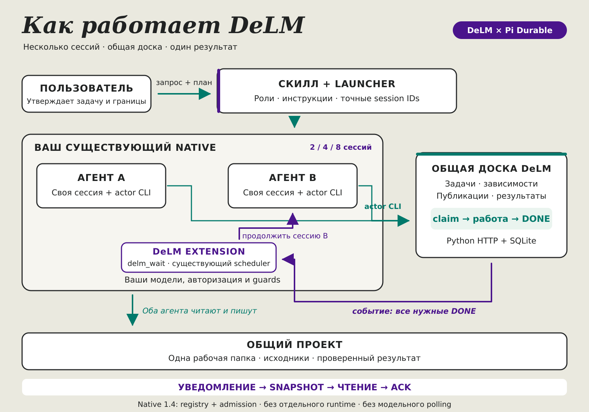

# DeLM для Pi Durable

**Несколько агентов, общая доска, один проект и один результат.** DeLM помогает разделить работу между агентами и передавать готовые результаты без ручного копирования ответов между чатами.

В пакете три основные части: Python-доска задач, расширение для Native Pi Durable и скилл подготовки команды. **Сам Durable, модели и авторизация не входят в поставку:** используются ваша установка и её сессии.

> **Статус совместимости.** Интеграция проверена на настоящем Native v1.0.2 с явным минимальным патчем трёх файлов, который добавляет локальный `DurableSession` API 1. Ни одна неизменённая stock-версия Native пока не объявлена совместимой. Обычный Pi CLI, один SDK или Pocket не заменяют этот интерфейс. [Что требуется от Native →](docs/native-compatibility.md)

## Зачем это нужно

Допустим, нужно добавить Unicode-slugify: один агент пишет функцию, второй проверяет кириллицу, пробелы и пустой ввод. Оба работают в одном проекте. Автор реализации публикует результат на доске; ожидающий агент получает событие в свою беседу, читает результат и продолжает проверку.

Для небольшого изменения одного агента обычно достаточно. DeLM полезен, когда есть действительно независимые направления: например, контракт данных, реализация, интерфейс и интеграционные тесты.

| Подход | Как передаётся работа |
|---|---|
| Один агент | Последовательно в одной беседе, без командной координации |
| Несколько отдельных чатов | Пользователь вручную переносит ответы и следит за состоянием |
| DeLM | Агенты читают общую доску, берут задачи и ждут конкретные результаты; пользователь получает общий итог |

Скилл помогает выбрать **2, 4 или 8** участников по полезным направлениям, а не по числу файлов. Восемь участников требуют отдельного разрешения и ресурсов: тест с восемью искусственными identities не доказывает работу восьми живых моделей.

## Как всё работает



[Открыть PNG](docs/images/delm-architecture.png) · [Редактируемый SVG](docs/images/delm-architecture.svg)

```text
Пользователь → утверждённый запрос и план
                         ↓
                 скилл delm + launcher
                         ↓
            отдельные точные сессии Native
             агент A               агент B
                ↕                     ↕
             actor CLI → общая доска ← actor CLI
                          ↓ событие
                    Native delm_wait
                          ↓
                  нужная беседа продолжена
                          ↓
            snapshot → чтение → явный ACK
                          ↓
                 один проверенный результат
```

1. **Подготовка.** Скилл читает разрешённые правила и готовый план, выбирает участников и сохраняет исходные инструкции в приватном каталоге запуска — `RUN`.
2. **Запуск.** Python backend обслуживает доску. Launcher подключается к явно указанному socket уже работающего Native, сохраняет точные session IDs и передаёт каждому его исходный input.
3. **Работа.** Участник читает доску, выигрывает атомарный `claim` и пишет только в согласованных пределах. Одновременно он может держать одну незавершённую задачу.
4. **Ранние результаты.** Готовый контракт или другой полезный output можно завершить отдельно, пока его автор продолжает остальную реализацию.
5. **Ожидание.** `delm_wait` ждёт все названные задачи в состоянии DONE либо подсказывает доступную работу. Событие доски возобновляет нужную сессию без модельного опроса.
6. **Подтверждение.** Короткое уведомление — только ссылка. Агент получает сохранённый snapshot, читает его и явно подтверждает ACK. Доставка уведомления сама по себе не означает чтения.

Доска владеет задачами, событиями и receipts. Native по-прежнему владеет беседами, моделями, scheduler и guards. Расширение использует существующие объекты Native: не создаёт второй Harness и не пишет напрямую в его SQLite.

## Что нужно перед запуском

- Python 3.10+ со stdlib `sqlite3`; `curses` нужен для терминального observer.
- POSIX-система и Node ≥22.19.0 для Native-интеграции.
- Уже установленный Native с session-facet loader и локальным `DurableSession` API 1.
- Публичные библиотеки из [`package.json`](package.json): Durable/AI/Chord `1.0.2 || 1.4.0` и `@earendil-works/pi-client` 1.0.2. Разрешение peers настраивает ваша среда; установщик payload зависимости не скачивает. Не смешивайте физические SDK разных версий.
- Утверждённый план и разрешение на запуск выбранных моделей. Tern необязателен.

### Что означает Native API 1

Это локальная точка подключения расширения к **существующей** сессии: её registry, conversation и движку выполнения. Внешним RPC-клиентам доступ к этим объектам запрещён.

В проверенном публичном Native этого интерфейса изначально нет. Отдельный [`public-host-api.patch`](extensions/delm/public-host-api.patch) показывает минимальное изменение для точной версии. Патч не применяется автоматически, чужая рабочая установка не пересобирается. Без совместимого API интеграция не поддерживается; Python-ядро можно попробовать независимо.

[Точный API-контракт](docs/native-compatibility.md) · [Подключение к существующему Native](docs/operations.md#подключить-к-существующему-native)

## Получить и установить пакет

GitHub-репозиторий содержит исходники; npm publish и готовый GitHub Release здесь не подразумеваются. Для локальной сборки нужен уже установленный npm:

```bash
git clone https://github.com/Diffuzmetall/pi-durable-delm.git
cd pi-durable-delm
export OUT="$(mktemp -d)"
npm pack --ignore-scripts --pack-destination "$OUT"
export ARCHIVE="$OUT/pi-durable-delm-0.1.0.tgz"
```

Команда `npm pack` не устанавливает зависимости и не публикует пакет. Если архив уже получен, задайте `ARCHIVE` его абсолютным путём. Перед выполнением кода проверьте происхождение и содержимое архива.

Первая установка в пустой временный каталог:

```bash
export SANDBOX="$(mktemp -d)"
export PREFIX="$SANDBOX/install"
mkdir "$SANDBOX/bootstrap"
tar -xzf "$ARCHIVE" -C "$SANDBOX/bootstrap" package/packaging/install.py
python3 "$SANDBOX/bootstrap/package/packaging/install.py" install "$ARCHIVE" --prefix "$PREFIX"
export PACKAGE="$PREFIX/current"
"$PACKAGE/bin/delm" --help
```

Ожидается JSON `status:installed`; повтор установки того же архива возвращает `unchanged`. Поле `native_registered:false` означает, что установлен только DeLM payload — Native ещё не подключён. Для постоянной установки выберите собственный стабильный `PREFIX`; временный каталог выше нужен для пробы.

## Попробовать без моделей

Этот пример запускает только настоящую Python-доску и CLI. Native и разрешение на модели не нужны.

```bash
export DEMO="$(mktemp -d)"
mkdir "$DEMO/project"
export RUN="$DEMO/run"
"$PACKAGE/bin/delm" init "$RUN" \
  --shared-workspace "$DEMO/project" --n 2 --task 'Проверить общую доску'
"$PACKAGE/bin/delm" serve "$RUN"
```

Backend работает в foreground: оставьте терминал открытым. Во втором терминале задайте `RUN` тем же путём и выполните:

```bash
"$RUN/alice/bin/context" domain '{"op":"projection"}'
python3 "$PACKAGE/scripts/delm_board.py" "$RUN" --observe
```

Projection показывает roster и очередь; observer отображает задачи и журнал. `q` закрывает только observer, Ctrl+C в первом терминале останавливает backend. Не запускайте повторный `init` ради продолжения: используйте `serve` прежнего RUN.

Небольшой пример готового результата:

```bash
python3 -B -m unittest discover -s "$PACKAGE/examples/slugify" -v
python3 "$PACKAGE/examples/slugify/slugify.py" 'Привет, мир!'
# привет-мир
```

## Подключить скилл и Native extension

Это **два разных подключения**:

- **Extension:** добавьте корень `$PACKAGE` к существующему набору session plugins вашего Native через его штатный loader. Сохраните остальные plugins и guards. Launcher наследует выбранный профиль, а не заменяет его одним DeLM.
- **Скилл:** подключите `$PACKAGE/skills/delm` штатным project-local способом до создания workers. Ниже `PROJECT` — существующий разрешённый проект:

```bash
mkdir -p "$PROJECT/.pi/skills"
python3 -c 'import sys; from pathlib import Path; Path(sys.argv[2]).symlink_to(sys.argv[1], target_is_directory=True)' \
  "$PACKAGE/skills/delm" "$PROJECT/.pi/skills/delm"
```

При существующем файле, каталоге или ссылке команда откажет с `FileExistsError`, не заменит запись и не создаст вложенную ссылку. Не удаляйте чужой скилл ради установки. Native кэширует skills в worker; для уже загруженного worker используйте поддержанный lifecycle, не dummy input.

Обычное поле `pi.skills` и парсер Pi не доказывают обнаружение скилла Native. Аналогично Durable adapter нельзя передать обычному Pi ExtensionAPI. [Подробный порядок подключения](docs/operations.md#подключить-к-существующему-native).

## Запустить команду по своему плану

Задайте абсолютные разрешённые пути:

- `PROJECT` — существующий проект с `AGENTS.md` и `PLAN.md`;
- `APPROVED_PROMPT` — файл с исходным утверждённым запросом;
- `GLOBAL_AGENTS` — действительно существующий разрешённый файл глобальных правил;
- `NEW_RUN` — новый приватный каталог вне проекта;
- `NATIVE_SOCKET` — точный Unix socket уже работающего совместимого Native в нужном workspace.

```bash
python3 "$PACKAGE/skills/delm/Tools/Run.py" prepare \
  --workspace "$PROJECT" --plan "$PROJECT/PLAN.md" \
  --prompt-file "$APPROVED_PROMPT" --global-agents "$GLOBAL_AGENTS" \
  --agents 2 --run-dir "$NEW_RUN"
python3 "$PACKAGE/skills/delm/Tools/Run.py" status --run-dir "$NEW_RUN"
```

`prepare` читает и сохраняет inputs, создаёт actor bindings и печатает команды backend/observer. **Ни сервисы, ни модели ещё не запущены.** Готовый план используется без нового интервью; отсутствие правил или права чтения нельзя подменить фиктивным «прочитал».

Запустите напечатанную команду `serve` в отдельном терминале. Затем, если extension подключён, API совместим и модели разрешены:

```bash
python3 "$PACKAGE/skills/delm/Tools/Run.py" start --run-dir "$NEW_RUN" --socket "$NATIVE_SOCKET"
python3 "$PACKAGE/skills/delm/Tools/Run.py" status --run-dir "$NEW_RUN"
python3 "$PACKAGE/scripts/delm_board.py" "$NEW_RUN" --observe
```

`start` создаёт ровно выбранные сессии и доставляет каждому его исходный input. Повтор сверяет прежние request IDs; пропавшая сохранённая сессия не заменяется новой молча. Проверьте общий результат в проекте и доказательства на доске.

| Команда launcher | Назначение |
|---|---|
| `capabilities` | Показать требования и возможности инструмента; не заменяет проверку работающего Native |
| `prepare` | Зафиксировать план, запрос, references и инструкции без запуска |
| `start` | Подключиться к существующему Native и передать исходные inputs |
| `status` | Прочитать состояние запуска и доски |
| `resume` | Возобновить те же сессии без dummy input |
| `notify` | Доставить новый явно утверждённый текст со стабильным request ID |
| `stop` | Остановить собственные wakers и точные беседы, не удаляя историю |

```bash
python3 "$PACKAGE/skills/delm/Tools/Run.py" resume --run-dir "$NEW_RUN"
python3 "$PACKAGE/skills/delm/Tools/Run.py" notify --run-dir "$NEW_RUN" \
  --actor alice --input-file "$APPROVED_UPDATE" --request-id approved-update-001
python3 "$PACKAGE/skills/delm/Tools/Run.py" stop --run-dir "$NEW_RUN"
```

`APPROVED_UPDATE` — разрешённый файл нового указания. После неопределённой доставки повторяют **тот же ID с теми же байтами**, а не создают другой run. Общий `--continue` по рабочей папке недопустим: он может выбрать чужую беседу. Launcher не читает и не отправляет editor draft. [Полная справка команд](skills/delm/Tools/Run.help.md).

## Где лежат данные и как остановить работу

| Место | Содержимое |
|---|---|
| Установленный пакет | Python, extension, skill, templates, vendor/license, tests и demo |
| Проект пользователя | Общие исходники и результат работы |
| Приватный RUN вне проекта | Задачи, события, receipts, frozen instructions, tokens и launch metadata |
| Собственное хранилище Native | Беседы, принятые inputs и scheduler |

Доска логически одна, но backup включает **`context.sqlite` и `context-bodies.sqlite`**. Не публикуйте RUN, `config.json`, токены, Native SQLite или личные беседы.

Остановка состоит из трёх действий: `Run.py stop`, выход из observer, остановка backend через Ctrl+C. Закрытое окно не доказывает остановку writers. `stop` может прервать генерацию, но не отменяет факт уже принятого input и не ACK-ает непрочитанный snapshot. Внешние shell-процессы проверяйте отдельно.

Перед удалением остановите работу, отключите только DeLM в неактивных Native sessions, сохраните остальные guards и уберите только созданную вами skill symlink с проверенным target. Затем используйте сохранённый bootstrap:

```bash
python3 "$SANDBOX/bootstrap/package/packaging/install.py" uninstall --prefix "$PREFIX"
```

Установщик сохраняет RUN, беседы и пользовательские изменения; изменённые version trees перечисляет в `retained`. Update и rollback требуют чистых управляемых файлов. **Перед downgrade к версии без work отмените или восстановите work-watchers в новой версии:** старая может принять пустой список задач за «все DONE». [Backup, update, rollback и удаление](docs/operations.md).

## Если что-то не работает

| Симптом | Что делать |
|---|---|
| Нет `DurableSession` API 1 или session loader | Проверить совместимость у владельца Native; не устанавливать другой host автоматически |
| Не разрешается public Node peer | Проверить библиотеки и их версии в вашей среде; payload installer их не скачивает |
| Второй backend не запускается | Найти действующего владельца `server.lock`; не удалять lock вслепую |
| Ошибка `STALE` при изменении задачи | Перечитать revision/generation и owner; не обходить fence |
| Нет пробуждения или receipt остаётся pending | Проверить все точные DONE, связанные FAIL и фактические snapshot/read/ACK |
| `FileExistsError` при установке скилла | Проверить существующий файл/каталог/ссылку; не перезаписывать чужой entry |

В bug report приложите версии, OS, artifact hash, точную команду, exit code и маленький фиктивный пример. Не отправляйте secrets, реальный RUN или conversation dump. [Безопасная диагностика](docs/operations.md#безопасный-bug-report).

## Проверки и границы

Установленная поставка прошла два независимых review и реальные Native-сценарии с **39 запросами к детерминированной localhost-модели; живых LLM-вызовов — 0**. Сам Native, transport, tools, guards, storage и доска настоящие. Проверены точное ожидание/readACK, доступная работа, конкурирующие claims, отсутствие пробуждения после cancel и последующего DONE, restart/reload, editor draft, pending/committed stop и удаление с сохранением данных.

Отдельно проверены core Python — 48 тестов, launcher — 21, установочные сценарии и SDK/faux. Это не обещание ускорения, качества моделей или поддержки любого Native. Полный отчёт отделяет fake-model, SDK и реальный host: [приёмка](docs/user-host-acceptance.md), [provenance](provenance.json), [parity](parity.json). [Архивный manifest принятого r2](docs/evidence/user-host/accepted-r2-manifest.json) сохраняет hash той поставки и оба независимых вердикта; это снимок проверенного архива, не manifest последующих редакций README.

- Файловая и ресурсная бронь **advisory**, не OS-lock; TTL не доказывает смерть writer.
- Work wake — только hint: он не назначает owner и не резервирует задачу.
- Native без указанного API, ordinary Pi, Pocket и Windows не объявлены поддержанными.
- Живые модели, восемь живых агентов и произвольные будущие миграции данных не проверялись.
- Проверенные source snapshots Native — внешние тестовые fixtures, не содержимое пакета и не обязательная установка другого Durable.

## Происхождение и лицензия

Основа — исследование [Decentralized Multi-Agent Systems with Shared Context](https://arxiv.org/abs/2606.10662v3), Mao et al., и [Python DeLM](https://github.com/yuzhenmao/DeLM), commit `66617616e708758f91624e5cc03659732b82f6a6`. Это наша адаптация для Native Pi Durable, **не официальный продукт авторов исследования**. Результаты статьи не переносятся в обещания этого пакета.

Наш код распространяется под [MIT](LICENSE). Полный [MIT notice исходного DeLM](vendor/DeLM/LICENSE) и [notice для контекста API-патча Native](LICENSES/pi-native.txt) сохранены. Отдельный [delm-agent-plugin](https://github.com/Decentralized-LM/delm-agent-plugin) — другой продукт; его Rust runtime и private-worktree архитектура сюда не включены.

[Архитектура](docs/architecture.md) · [Эксплуатация](docs/operations.md) · [Контракт доски](docs/DeLM-domain-protocol.md) · [Native delivery](docs/DeLM-native-protocol.md) · [UPSTREAM](UPSTREAM.md) · [THIRD_PARTY_NOTICES](THIRD_PARTY_NOTICES.md)
